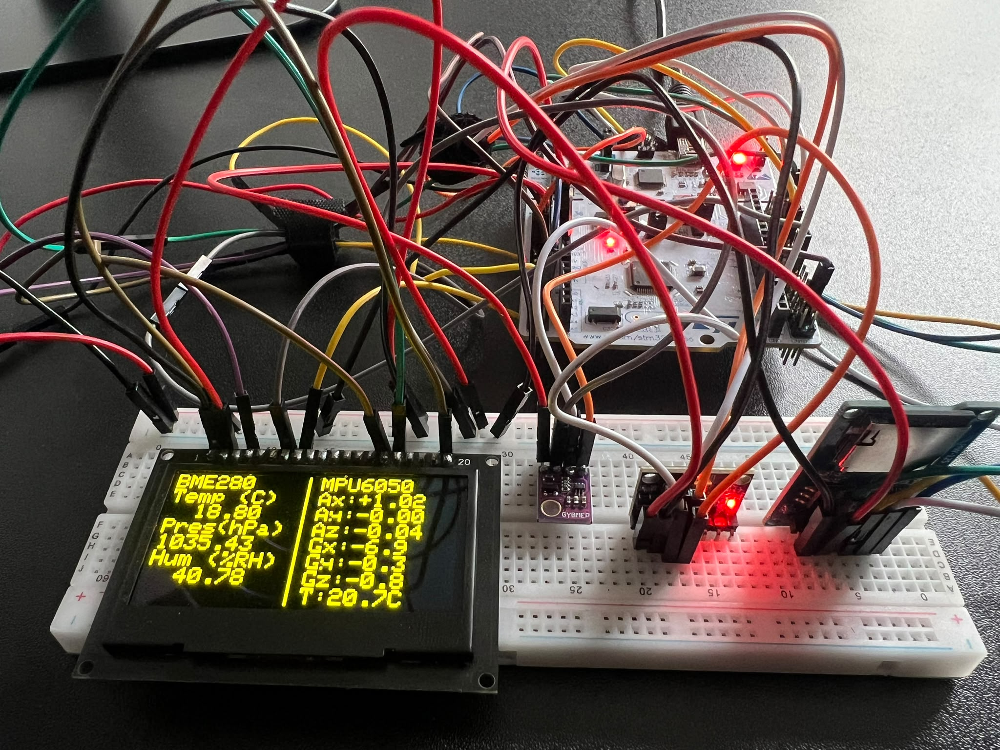

# FreeRTOS Motion & Environment Logger

An STM32F401RE project that samples motion and environmental data, saves readable logs to a microSD card, and displays live readings on a 128×64 OLED. A UART command shell controls sampling, logging, the display, and access to saved files.

## Features

- **MPU6050:** acceleration on three axes, angular velocity on three axes, and temperature.
- **BME280:** temperature, atmospheric pressure, and relative humidity, compensated using Bosch's driver.
- **Sampling:** separate FreeRTOS tasks with a nominal 250 ms interval per sensor. I2C reads use interrupts and completion signaling.
- **File logging:** readable text appended to separate sensor files through FatFs and a custom SPI SD driver. Readings are batched in 512-byte buffers; only valid text bytes are written.
- **OLED:** BME280 readings on the left and MPU6050 readings on the right, updated through a shared display queue.
- **UART shell:** DMA reception and DMA transmission of file contents, with task notifications for transfer completion.
- **Independent controls:** pause each sensor, freeze either display section, or pause logging for both sensors while sampling and display updates continue.
- **File management:** list files and sizes, read either sensor log, abort a read, and clear either log.

## Hardware and connections

- STM32 NUCLEO-F401RE
- MPU6050 and BME280 sensor modules
- microSD card and SPI module
- 2.42-inch 128×64 SPI OLED (SSD1309), using the included SSD1306 library

The following signals match the firmware configuration. Both sensors share I2C1; the SD card and OLED use separate SPI peripherals.

| Connection | STM32 pin(s) |
| --- | --- |
| I2C1 SCL / SDA — both sensors | PB6 / PB7 |
| SD SPI1 SCK / MISO / MOSI | PA5 / PA6 / PA7 |
| SD chip select | PA4 |
| OLED SPI2 clock / data output | PB10 / PC3 |
| OLED chip select / DC / reset | PB0 / PC4 / PC5 |
| USART2 TX / RX | PA2 / PA3 |

Use a common ground and power each module according to its specifications. The OLED does not need a MISO connection.

## Getting started

1. Import this repository as an existing project in **STM32CubeIDE**.
2. Connect the hardware and insert a **FAT32-formatted microSD card**. The current FatFs configuration does not support exFAT.
3. Build and flash the project using ST-LINK.
4. Open the board's serial port at **115200 baud, 8 data bits, no parity, 1 stop bit, and no flow control**.
5. Reset the board, wait for `SD mounted successfully.`, and enter `help` followed by Enter.

The firmware retries mounting the card if mounting fails. Sensor sampling, logging, and live display are enabled by default. The OLED shows `Waiting` until a reading is received.

The `.ioc` file contains the CubeMX configuration. When regenerating code, preserve the application code and settings, including the FreeRTOS heap size of **30720 bytes**. Float formatting must remain enabled in the linker settings (`-u _printf_float`).

## Shell commands

Commands are lowercase and are executed when you press Enter.

| Command | Action |
| --- | --- |
| `help` | Show available commands. |
| `list files` | List files and sizes in the SD root directory. |
| `read mpu` | Print the saved MPU6050 file over UART. |
| `read bme` | Print the saved BME280 file over UART. |
| `abort read` | Stop the file dump after the current transmitted chunk. |
| `pause mpu` | Pause MPU6050 sampling. |
| `resume mpu` | Resume MPU6050 sampling. |
| `pause bme` | Pause BME280 sampling. |
| `resume bme` | Resume BME280 sampling. |
| `pause live mpu` | Freeze the MPU6050 values on the OLED. |
| `resume live mpu` | Resume MPU6050 OLED updates. |
| `pause live bme` | Freeze the BME280 values on the OLED. |
| `resume live bme` | Resume BME280 OLED updates. |
| `pause logging` | Stop queuing new file batches for both sensors. |
| `resume logging` | Resume file logging for both sensors. |
| `clear mpu` | Empty the MPU6050 file while keeping its filename. |
| `clear bme` | Empty the BME280 file while keeping its filename. |

Pausing sampling also stops new log and display readings from that sensor. Pausing OLED updates affects only the display. Batches already queued can finish writing after `pause logging`.

For a useful terminal demonstration, run `help`, `list files`, and `read mpu`. Use `abort read` to stop a long dump.

## Saved data

The files are stored in the SD card's root directory:

| File | Contents |
| --- | --- |
| `MPU6050.BIN` | Acceleration in g, angular velocity in degrees per second (dps), and temperature in °C. |
| `BME280.BIN` | Temperature in °C, pressure in Pa, and relative humidity in %RH. |

Despite the `.BIN` extension, both files contain readable text. The OLED shows BME280 pressure in hPa instead of Pa.

New batches are appended to existing files. A partial batch remains in RAM until enough readings arrive to send it, so the newest readings may not yet be on the card. Pause logging before clearing a file if you want it to remain empty.

During a file dump, the read task owns the SD mutex, so file writes wait until the dump ends. Sensor sampling and OLED updates can continue, but queued log batches can fill up; new readings are skipped when a full batch cannot be queued.

## Software structure

Seven application tasks handle the two sensors, OLED drawing, SD logging, SD file reading, and shell reception and printing. Queues carry log batches, display readings, file-read requests, and shell messages. Mutexes protect shared I2C, SD, and UART access; a binary semaphore signals I2C read completion.

| Location | Purpose |
| --- | --- |
| `Core/Src/mpu6050.c`, `bme280.c` | Sensor initialization, sampling, decoding, and log formatting. |
| `Core/Src/oled.c` | Display task and screen layout. |
| `Core/Src/sd.c` | SPI SD driver, file logging, reading, clearing, and listing. |
| `Core/Src/shell.c` | UART shell and command handling. |
| `Core/Src/freertos.c` | Application task, queue, mutex, and semaphore creation. |
| `FATFS/Target/user_diskio.c` | Connects FatFs disk operations to the SD driver. |
| `docs/` | Project photos and documentation images. |

## Libraries

Built with STM32 HAL, FreeRTOS, and FatFs. Sensor compensation uses the [Bosch BME280 driver](https://github.com/boschsensortec/BME280_driver), and OLED drawing uses [stm32-ssd1306](https://github.com/afiskon/stm32-ssd1306). Third-party license notices are retained in their source files.
